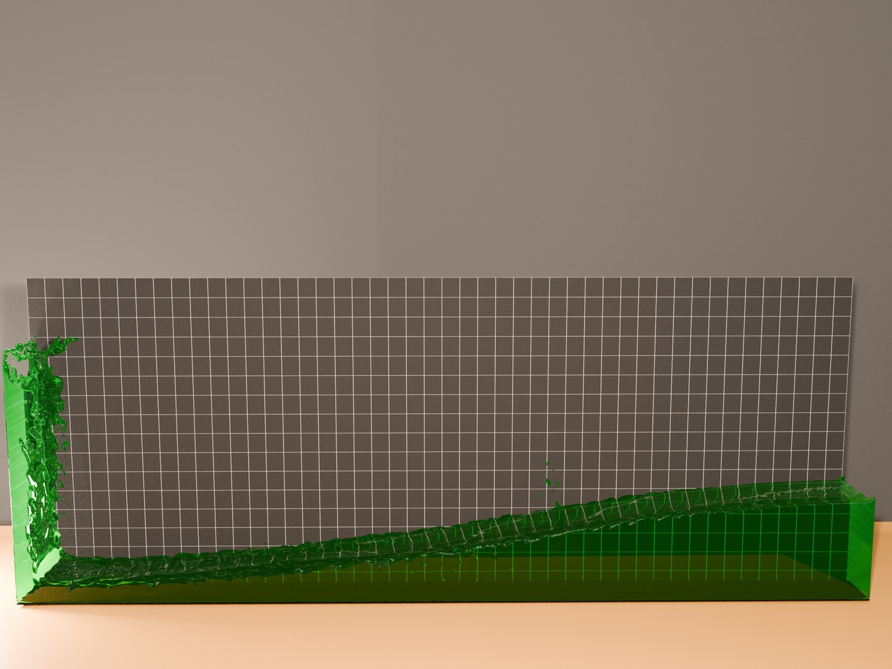
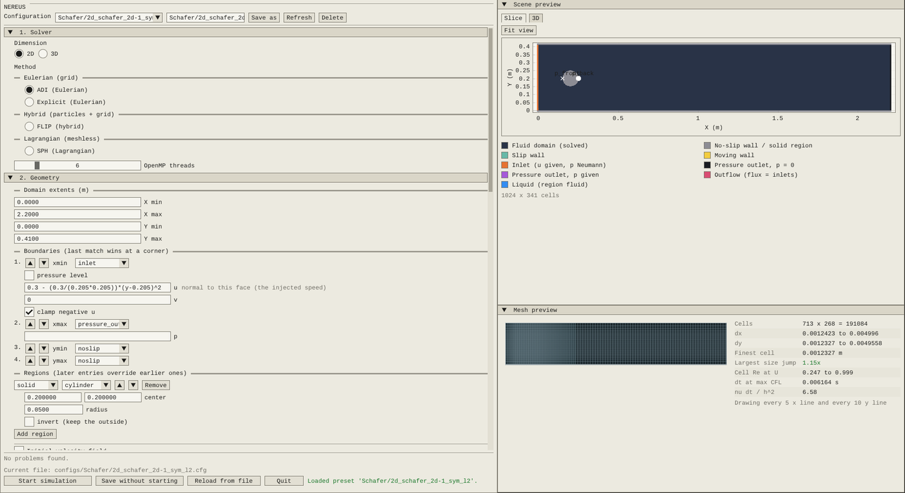
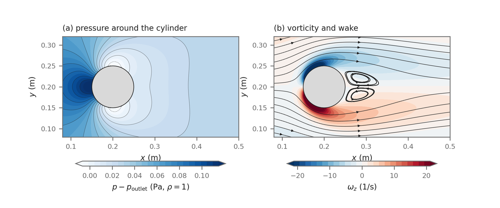
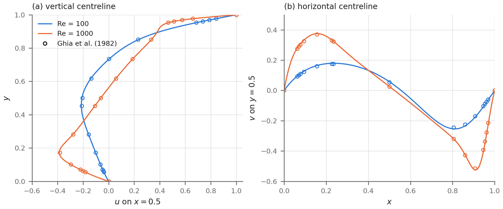

<p align="center">
  <picture>
    <source media="(prefers-color-scheme: dark)" srcset="docs/assets/nereus_logo_dark.svg">
    
  </picture>
</p>

<p align="center">
  <b>Navier&ndash;Stokes Extensible Research Unified Solver</b><br>
  A C++ framework for implementing, validating and comparing numerical methods for incompressible flow.
</p>

<p align="center">
  
  <a href="LICENSE"></a>
  
  
  
  <a href="#documentation"></a>
</p>

<p align="center">
  <a href="#quick-start">Quick start</a> &middot;
  <a href="#describing-a-case">Describing a case</a> &middot;
  <a href="#adding-a-method">Adding a method</a> &middot;
  <a href="#validation">Validation</a> &middot;
  <a href="#documentation">Documentation</a> &middot;
  <a href="#citing-nereus">Citing</a>
</p>

---

NEREUS solves the incompressible Navier&ndash;Stokes equations in two and three dimensions with Eulerian,
hybrid particle&ndash;grid and meshless methods that share one infrastructure. The framework supplies what every
solver needs and none is specific to: a staggered Marker-and-Cell grid on uniform or stretched rectilinear
meshes, boundary conditions, a pressure Poisson solver on the CPU and on NVIDIA GPUs, scenes described in a
configuration file, telemetry, exports, checkpoints and an optional real-time interface. A method is a folder
that declares its capabilities and the steps it runs; the program registers it in one line.

<table>
  <tr>
    <td width="50%"></td>
    <td width="50%"></td>
  </tr>
  <tr>
    <td align="center"><sub>3D dam break against Lobovsk&yacute; et al. (2014), FLIP, rendered in Blender from the exported surface</sub></td>
    <td align="center"><sub>The setup screen: scene, boundary conditions and grid preview</sub></td>
  </tr>
  <tr>
    <td></td>
    <td></td>
  </tr>
  <tr>
    <td align="center"><sub>Flow past a cylinder (Sch&auml;fer et al. 2D-1), ADI on a stretched grid</sub></td>
    <td align="center"><sub>Lid-driven cavity centrelines against Ghia et al. (1982)</sub></td>
  </tr>
</table>

## Features

**Methods**

| Key | Family | Dimensions | Description |
|---|---|---|---|
| `ADI` | Eulerian | 2D, 3D | Finite volumes on the MAC grid, alternating-direction-implicit momentum sweeps, Chorin or incremental pressure projection, central or upwind convection in advective or flux form, stretched grids |
| `FLIP` | Hybrid | 2D, 3D | PIC/FLIP for free-surface flows, an implicit viscous solve, optional density correction (Kugelstadt et al. 2021) |
| `SPH` | Lagrangian | 2D, 3D | Weakly compressible SPH: Wendland C2 kernel, &delta;-SPH density diffusion, mirror ghost particles at walls and solids |
| `EXPLICIT` | Eulerian | 2D | Forward Euler with its own SOR pressure solve: the worked example of adding a method, 194 lines |

**Infrastructure**

- **Grid**: staggered MAC grid, uniform or stretched rectilinear (hard, ramped and graded refinement bands), with
  interpolation, gradients and divergence on the face and centre tables.
- **Boundary conditions**: no-slip, slip and moving walls, velocity inlets, pressure outlets and a continuity
  outflow, with values given as expressions in `x y z t`. The particle methods (FLIP, SPH) run closed domains with
  fixed walls only: they do not inject or remove particles at a boundary, and walls do not move.
- **Geometry**: solid regions as signed distance fields (box, sphere, cylinder, plane, NACA 00XX airfoils, closed
  STL meshes), voxelised onto the grid.
- **Pressure solver**: one assembly for every method, solved with Eigen (CG, BiCGSTAB) or AMGCL on the CPU, or
  NVIDIA AMGX on the GPU.
- **Scalar transport**: passive scalars with advection, diffusion, reaction and sources.
- **Output**: ParaView `.vtr` fields, particle CSV, watertight PLY liquid surfaces for rendering, `.npy` volumes,
  a telemetry CSV (timings, divergence, residual, forces, energy, probes) and checkpoints.
- **Interface**: a setup screen that edits and previews a case, and a viewer with fields, streamlines, particles
  and live telemetry. Everything also runs headless from the configuration file alone.
- **Parallelism**: OpenMP on shared memory; the pressure solve optionally on the GPU.

## Quick start

### Requirements

A C++17 compiler and `make`. Eigen, Dear ImGui, ImPlot, ImPlot3D, GLFW, AMGCL and tinyexpr are bundled.

| System | Install once |
|---|---|
| Linux | `g++`, `make`, and for the window the X11 headers (`libx11-dev libxrandr-dev libxinerama-dev libxcursor-dev libxi-dev`) or GLFW (`libglfw3-dev`) |
| Windows | [MSYS2](https://www.msys2.org); in its MINGW64 shell: `pacman -S mingw-w64-x86_64-gcc make` |
| macOS | Xcode command line tools (`xcode-select --install`); for multithreading `brew install libomp` |

The GPU pressure solver is optional and Linux only; every case also runs on the CPU solvers. See
[GPU build](#gpu-build-optional) below.

### Build

```bash
make -j            # bin/nereus: the interface, and headless runs with --headless
make HEADLESS=1 -j # bin/nereus_headless: no window code at all
make info          # what the build will use, without building
```

| Option | Effect |
|---|---|
| `NVIDIA_GPU=auto\|0\|1` | the AMGX pressure solver (Linux); `auto` enables it when CUDA and AMGX are found |
| `AMGX_PATH=`, `CUDA_PATH=` | where AMGX and CUDA are installed |
| `EIGEN_PATH=` | another Eigen 3.3+ instead of the bundled one |
| `OPENMP=0` | a serial build |
| `DEBUG=1` | `-O0 -g` with assertions |

`bin/nereus --build-info` prints the version and `gpu 1` or `gpu 0`, so you can check which pressure solvers a
binary was built with.

### GPU build (optional)

The GPU pressure solver uses [AMGX](https://github.com/NVIDIA/AMGX) and needs, on Linux:

- an NVIDIA driver and the CUDA toolkit (developed with CUDA 12.8; `CUDA_PATH`, default `/usr/local/cuda`);
- an MPI implementation with its development files, which AMGX links against by default
  (on Debian/Ubuntu: `sudo apt install libopenmpi-dev`);
- AMGX built from source, following its own instructions (developed with AMGX 2.5.0):

```bash
git clone --recursive https://github.com/NVIDIA/AMGX.git ~/SDK/AMGX
cd ~/SDK/AMGX && mkdir build && cd build
cmake .. && make -j
```

The Makefile looks for the headers in `$AMGX_PATH/include` and the libraries in `$AMGX_PATH/build`, which is where
the commands above leave them; `AMGX_PATH` defaults to `~/SDK/AMGX`. For AMGX elsewhere, point `AMGX_PATH` at its
source tree (the folder holding `include/` and `build/`).

With `NVIDIA_GPU=auto` (the default) the GPU solver is compiled only when `$AMGX_PATH/build/libamgxsh.so` and
`$CUDA_PATH/include/cuda_runtime.h` both exist; otherwise the build is CPU-only, without an error. To require the GPU
build, so that a missing dependency stops the build instead, use

```bash
make NVIDIA_GPU=1 AMGX_PATH=/path/to/AMGX CUDA_PATH=/usr/local/cuda -j
bin/nereus --build-info   # gpu 1
```

AMGX is linked statically, so the program needs only the CUDA and MPI shared libraries at run time. A case runs on
the GPU when its configuration sets `GPU_ACCELERATION = 1`. In a CPU-only build that setting is switched off with a
warning, and the case runs on the CPU solvers.

### Run

```bash
bin/nereus                                                     # the setup screen; pick a preset, press Start
bin/nereus --headless configs/Ghia/2d_ghia_re100.cfg           # the same case without a window
bin/nereus_headless configs/Ghia/2d_ghia_re100.cfg --progress 500 --quiet
```

A headless run ends when the case's stopping rule fires and returns `0`; `1` for a usage or configuration
error, `2` if the field went non-finite and `3` if it was interrupted (SIGINT or SIGTERM finish the current
step and write a checkpoint when the case names one). Results go to `<EXPORT_BASE_PATH>/<case name>/`.

Paths are relative to the folder the program runs in. Started with no config (the setup screen) from anywhere but
the project root, for example from `bin/` or by double-clicking it, the program finds the project root next to or
above the executable and works from there. A run given a config path stays where it was started, so its results land
beside that case.

### Test run

The lid-driven cavity at Re 100 on a 64 x 64 grid runs in about ten seconds on one thread, and its expected
output ships with the repository. The run writes into the same folder, so set the expected file aside first:

```bash
cp Validation/FVM_ADI/results/ldc_2d_re100_n64_adi/64_2D_re100/telemetry.csv expected_telemetry.csv
bin/nereus_headless configs/Explicit/ldc_2d_re100_n64_adi.cfg
tail -n 1 Validation/FVM_ADI/results/ldc_2d_re100_n64_adi/64_2D_re100/telemetry.csv
tail -n 1 expected_telemetry.csv
```

Both last rows should read iteration 7680 at t = 60 with a residual near 3e-12 and a divergence sum near
1.8e-6; the timing columns depend on the machine. The run also writes the final field as a `.vtr` file for
ParaView. The same case under the EXPLICIT method is `configs/Explicit/ldc_2d_re100_n64_explicit.cfg`.

## Describing a case

A case is one configuration file: the settings as `KEY = value` lines, and the geometry and boundary
conditions in a scene block. Every key has a default, so a case states only what it changes:

```ini
# Flow past a cylinder (Schäfer et al. 2D-1, Re 20) on the ADI method
DIMENSION = 2
TYPE = ADI
DOMAIN_XF = 2.2
DOMAIN_YF = 0.41
GRID_SIZE = 41          # cells across the shorter of x and y
VISCOSITY = 0.001
TIME_STEP = 0.005
STOP_CONDITION = TIME
STOP_TIME = 8

SCENE_BEGIN
sampling center
boundary xmin inlet u="4*0.3*y*(0.41-y)/(0.41*0.41)"
boundary xmax pressure_outlet
boundary ymin noslip
boundary ymax noslip
region solid cylinder axis=z center=(0.2,0.2) radius=0.05
SCENE_END
```

Switching `TYPE` runs the same case with another method; each method reads its own settings block and ignores
the others. The presets under [`configs/`](configs) cover every validation case, and the setup screen writes
and edits these files.

## Adding a method

A method lives in its own folder under `src/Methods/` and needs no change to the library. It declares a row,
the capabilities it uses and the steps it runs; the framework handles the grid, boundaries, pressure solver
(if requested), telemetry, exports and the interface. The explicit method, in full:

```cpp
static inline void InitializeExplicit()
{
    MAC::InitializeSimulationGrids();
    RegisterSimulationStep(Explicit2D::Momentum,   "momentum",   0);
    RegisterSimulationStep(Explicit2D::Pressure,   "pressure",   4);
    RegisterSimulationStep(Explicit2D::Projection, "projection", 6);
}

static inline void RegisterExplicit()
{
    RegisterSimulationMethod({"EXPLICIT", "Explicit (Eulerian)",
        "Forward Euler momentum and an SOR pressure solve, 2D uniform grids",
        MethodFamily::EULERIAN, true, false, CAP_GRID | CAP_BOUNDARY_CELLS | CAP_FIXED_REGION,
        InitializeExplicit, nullptr,
        &EXPLICIT_SETTINGS, EXPLICIT_FIELDS, (int)(sizeof(EXPLICIT_FIELDS) / sizeof(EXPLICIT_FIELDS[0])), nullptr,
        nullptr, Explicit2D::StableTimestep, nullptr, nullptr, nullptr});
}
```

and one line in the program, `RegisterExplicit();`. The [API reference](#documentation) walks through it step by step.

## Validation

Every case below has a preset, and `./run_all_validation.sh` runs them all headless, cheapest first, resuming
an interrupted batch.

| Case | Methods | Reference | Presets |
|---|---|---|---|
| Taylor&ndash;Green vortex, convergence in space and time | ADI | exact solution | [`configs/TGV`](configs/TGV) |
| Ethier&ndash;Steinman, 3D convergence | ADI | Ethier &amp; Steinman (1994) | [`configs/ES`](configs/ES) |
| Lid-driven cavity, Re 100 and 1000 | ADI, EXPLICIT | Ghia et al. (1982) | [`configs/Ghia`](configs/Ghia), [`configs/Explicit`](configs/Explicit) |
| Flow past a cylinder and a square, 2D-1, 3D-1Q, 3D-1Z | ADI | Sch&auml;fer et al. (1996) | [`configs/Schafer`](configs/Schafer) |
| Dam break, column height and front | FLIP, SPH | Martin &amp; Moyce (1952) | [`configs/MartinMoyce`](configs/MartinMoyce) |
| Dam break, impact pressure and levels, 2D and 3D | FLIP, SPH | Lobovsk&yacute; et al. (2014) | [`configs/Lobovsky`](configs/Lobovsky) |
| Viscous dam break | FLIP | Ancey et al. (2009) | [`configs/Ancey`](configs/Ancey) |
| Memory and parallel scaling, 3D cavity | ADI | &ndash; | [`configs/Scalability`](configs/Scalability) |

The lid-driven cavity is also compared with OpenFOAM (icoFoam) for accuracy and cost per step.

## Documentation

- **API reference**: [`docs/api/nereus_api.pdf`](docs/api/nereus_api.pdf), built from
  [`docs/api/nereus_api.tex`](docs/api/nereus_api.tex). It covers building and running, the case file, the simulation manager, the MAC grid and its boundary
  conditions, the method registry, the pressure solver, transport, particles, probes and telemetry, with the
  explicit method as a worked example.

## Repository layout

```
src/
  main.cpp                 the program: register the methods, run headless or with the interface
  MAC.cpp, ...             the grid, scalar transport, setup screen
  headers/Core/            simulation manager, MAC grid, scenes, particles, exports, checkpoints
  Methods/<X>/             one folder per method: ADI, FLIP, SPH, Explicit, and the shared PPESolver
  UI/                      the interface (GUI builds only)
configs/                   case files, one folder per validation case
docs/                      API reference and assets
include/                   bundled third-party libraries
tests/                     development test suites (tests/run_all.sh; see tests/README.md)
run_all_validation.sh      runs every validation case headless
```

## Citing NEREUS

A paper describing NEREUS is under review. Until it is published, please cite this repository; a citation entry
will be added here.

## License

NEREUS is distributed under the [Mozilla Public License 2.0](LICENSE). It may be used in any program,
proprietary ones included; modified files of NEREUS that are distributed must be made available in source form
under the same license.

Bundled third-party code keeps its own license, in the file beside it:

| Library | Path | License |
|---|---|---|
| Eigen | `include/eigen-3.3.7/` | MPL-2.0 |
| Dear ImGui | `include/imgui-1.92.4` | MIT |
| ImPlot | `include/implot-0.17` | MIT |
| ImPlot3D | `include/implot3d-0.3` | MIT |
| GLFW | `include/glfw-3.4` | zlib |
| AMGCL | `include/amgcl` | MIT |
| tinyexpr | `include/tinyexpr` | zlib |
| stl_reader | `include/stl_reader` | BSD-2-Clause |
| TriangleMeshDistance | `include/tmd` | MIT |
| Cousine font | `include/imgui-1.92.4/misc/fonts` | SIL Open Font License 1.1 |

NVIDIA AMGX (BSD-3-Clause) and the CUDA toolkit are optional and not distributed.
